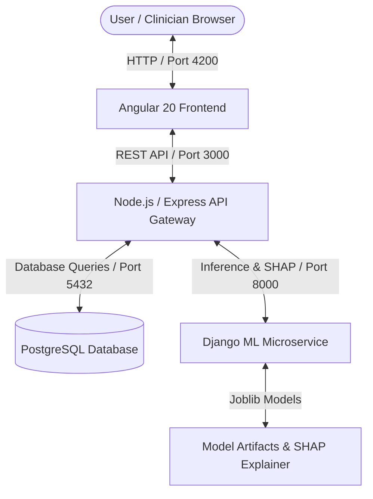

# CardioSight: Intelligent Cardiovascular Risk Prediction & Clinical Decision Support System

[]()
[]()
[]()
[]()
[]()
[]()
[]()

CardioSight is a multi-modal cardiovascular risk assessment platform developed for academic research and clinical decision support. It bridges machine learning predictions and medical interpretability by combining:

1. **10-Year Coronary Heart Disease (CHD) Risk Estimation**: Powered by a calibrated Random Forest classifier trained on the Framingham Heart Study cohort.
2. **Explainable AI (XAI)**: Driven by mathematical SHAP (TreeExplainer) feature attributions, waterfall probability shifts, and global Gini feature importance.
3. **ECG Report Analysis**: Automated clinical parameter extraction from 12-lead ECG PDF reports evaluated against AHA/ACC thresholds and PTB-XL diagnostic categories.
4. **Treadmill Exercise Stress Test (TMT) Analysis**: Dual stratification incorporating the clinical Duke Treadmill Score (DTS) and a machine learning model trained on genuine UCI Cleveland Heart Disease data.
5. **Secure Patient Data Management**: Authentication, profile management, and persistent evaluation histories backed by PostgreSQL.

---

## 📚 Documentation Index

Depending on your background and needs, choose the appropriate guide below:

| Guide | Description | Target Audience |
| :--- | :--- | :--- |
| 📘 **[Professor Setup Guide](./PROFESSOR_SETUP_GUIDE.md)** | **Start here!** A calm, patient, step-by-step guide with zero programming knowledge assumed. Explains how to install and run CardioSight from scratch. | **Professors, Evaluators, Beginners** |
| ⚡ **[Professor Quick Start](./PROFESSOR_QUICK_START.md)** | A concise 1-page daily cheat sheet for launching the application after initial installation. | **Returning Users** |
| 🔬 **[Technical Documentation](./TECHNICAL_DOCUMENTATION.md)** | Comprehensive technical manual covering architecture, API endpoints, database schemas, ML mathematics, and security. | **Developers & Technical Reviewers** |

---

## 🏛️ System Architecture

CardioSight is structured into decoupled, specialized services:



1. **Frontend (Port 4200)**: Modern Angular 20 interface with reactive Material Design components, interactive risk meters, and dynamic Chart.js visualizations.
2. **Backend Gateway (Port 3000)**: Node.js & Express REST API managing authentication (JWT), request routing, investigation PDF extraction, and PostgreSQL data persistence.
3. **ML Microservice (Port 8000)**: Python / Django server providing scikit-learn model inference and real-time SHAP feature attributions.
4. **Database (Port 5432)**: Relational PostgreSQL database storing user credentials, patient clinical profiles, predictions, and cached SHAP explanations.

---

## 🚀 Quick Launch Overview

For complete, detailed instructions, please consult the **[Professor Setup Guide](./PROFESSOR_SETUP_GUIDE.md)**. If your computer already has prerequisites configured, start the services in separate Terminal windows:

### 1. Database (PostgreSQL)
Ensure PostgreSQL is active:
```bash
brew services start postgresql@16   # macOS (or use Postgres.app / Windows service)
```

### 2. Machine Learning Service (Terminal 1)
```bash
cd ML
source .venv/bin/activate            # On Windows: .venv\Scripts\activate
python manage.py runserver 127.0.0.1:8000
```
*Health Check*: `http://127.0.0.1:8000/api/health`

### 3. Backend API Gateway (Terminal 2)
```bash
cd Backend
npm start
```
*Health Check*: `http://localhost:3000/api/health`

### 4. Frontend Web Application (Terminal 3)
```bash
cd Frontend
npm start
```
*Application URL*: Open **`http://localhost:4200`** in Google Chrome or any modern browser.

---

## 🔑 Default Demonstration Account

A pre-configured administrator account is seeded during installation:
- **Email**: `admin@cardiosight.local`
- **Password**: `Admin@12345`

You may also click **"Create an account"** on the login page to register a fresh patient profile.

---

## 🧪 Verification & Test Suite

The repository includes extensive automated verification suites covering all architectural layers:

```bash
cd Backend
node test_investigations.js   # 104 tests (ECG, TMT, PDF parsing, AHA/ACC heuristics)
node test_auth_dashboard.js   # 36 tests (Authentication, user isolation, dashboard)
node test_xai.js              # 36 tests (SHAP consistency, TreeExplainer, waterfall)
```
**Test Results**: **176 Passed, 0 Failed (100% Pass Rate)**

---

## ⚠️ Academic Disclaimer

CardioSight is developed strictly for educational, research, and technical evaluation purposes. The predictions, SHAP feature attributions, and clinical rule heuristics generated by this software represent statistical machine learning models and must never replace clinical assessment, diagnostic testing, or therapeutic advice from a licensed physician or board-certified cardiologist.
